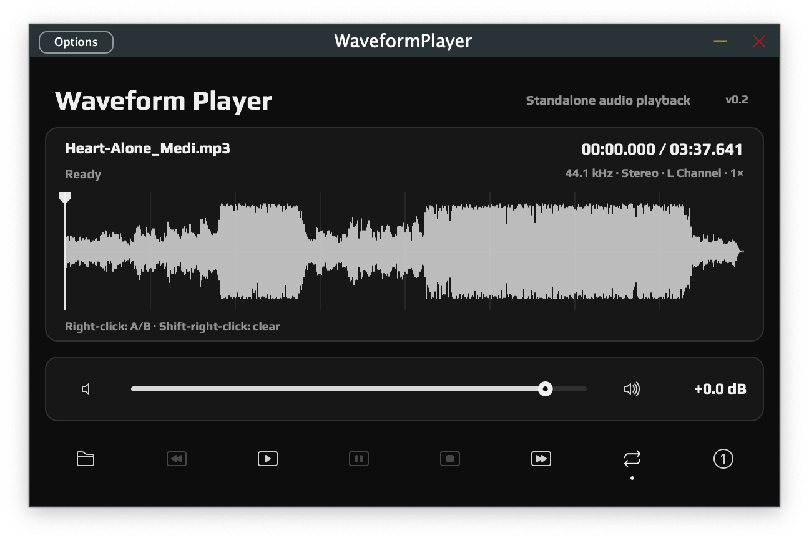

# Waveform Player

A compact audio file player for exploring waveforms, repeating passages, and adjusting playback speed. Use it as a VST3 or Audio Unit plug-in, or as a standalone macOS app.

## Features

- **WAV, MP3, and FLAC playback** — Open mono or stereo audio files and see the filename, sample rate, playback position, and duration.
- **Waveform navigation** — Left-click or drag on the waveform to seek while keeping the current playing or paused state. Stereo files display the left-channel waveform.
- **Playback controls** — Play from the current position, pause without losing your place, or stop and return to the beginning of the file or selected A/B range. Rewind and fast-forward move by five seconds.
- **Whole-file and A/B looping** — Repeat an entire file or a selected passage. With Loop off, playback stops at the end and returns to the beginning of the active range.
- **Four playback speeds** — Cycle through **1×, 2×, 4×, and 8×**. Changing speed keeps your position and playback state; pitch changes along with speed.
- **Volume and mute** — Adjust output from **−60 dB to +6 dB**, or double-click the slider to reset to **0 dB**. Mute and unmute without changing the volume setting.
- **Independent playback** — The plug-in's playback controls operate independently of the DAW's transport.
- **Compact dark interface** — Waveform, file information, volume, and icon controls in one view, with hover tooltips for controls and their current states.

## A/B Range Playback

1. **Right-click** the waveform to place the first marker.
2. **Right-click a different position** to place the second marker. The earlier point becomes **A**, the later point becomes **B**, and the range is highlighted. The playhead returns to A while keeping the current playing or paused state.
3. Turn on **Loop** to repeat the selected passage, or leave it off to play through the range once.

While an A/B range is active, waveform seeking and five-second skips stay within the range, and **Stop** returns to A.

**Right-click again** to begin a new pair of markers. **Shift + right-click** anywhere in the waveform clears both markers without changing your position or playback state. Loading a new audio file clears the markers.

## Available Formats

| Format | File | Use |
| --- | --- | --- |
| **VST3** | `WaveformPlayer.vst3` | Instrument plug-in for compatible DAWs and plug-in hosts. |
| **Audio Unit (AU)** | `WaveformPlayer.component` | Audio Unit generator plug-in for compatible macOS hosts. |
| **Standalone App** | `WaveformPlayer.app` | A macOS app for playback without a DAW. |
